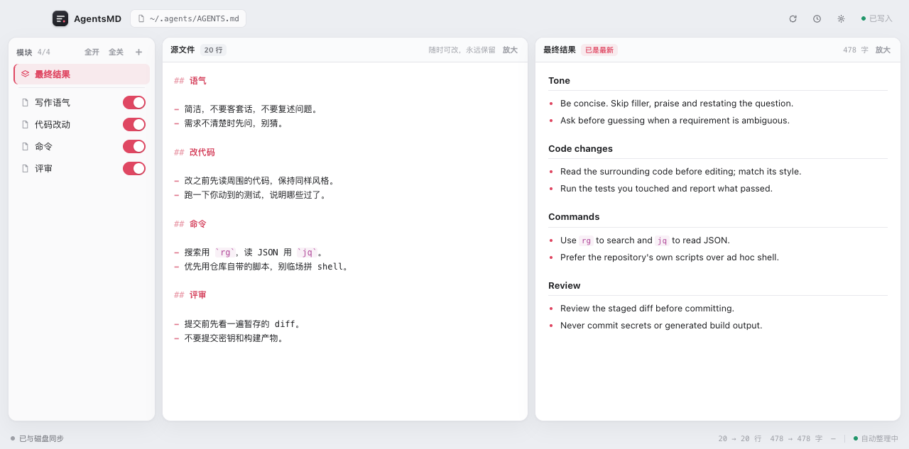

# AgentsMD

A macOS app for the one file every coding agent reads: `~/.agents/AGENTS.md`.

You keep writing in your own words, in your own language. AgentsMD organizes
that text into the document agents actually read — translated, de-duplicated,
compressed to the rules that matter — while your original stays untouched.

<!-- Screenshot: replace with docs/screenshot.png once captured -->
<!--  -->

## Why

`AGENTS.md` is a prompt file that grows by accretion: repeated rules, three
ways of saying "be concise", a paragraph of history nobody needs, mixed
languages. It is read by every agent on every task, so every redundant line
costs attention forever.

AgentsMD treats the file like a hosts file manager treats `hosts`: the raw text
is yours and is never rewritten, and what lands in `AGENTS.md` is generated
from it.

## Features

- **Two panes, one document.** The left pane is always your source file, fully
  editable. The right pane is the result agents read, always in full. Picking a
  section marks it in both.
- **Modules from headings.** Every `##` heading becomes a module with its own
  switch. Turning one off removes it from `AGENTS.md` without touching your
  text.
- **Three rewrites, on by default.** Translate prose to English, strip filler
  and repetition, merge duplicate or conflicting rules. Paths, commands, code
  spans and URLs are preserved verbatim.
- **Headings translated too.** A Chinese section publishes as an English one in
  `AGENTS.md`, while the sidebar keeps the name you wrote.
- **Only what changed is re-sent.** Each rewrite records the hash of the text it
  came from. Editing one section never rewords the others, and a restart spends
  no model calls on unchanged text.
- **Waits for you.** Rewrites are debounced and never repaint the editor, so
  typing — including IME composition — is never interrupted. A rewrite landing
  mid-sentence does not move your cursor.
- **Your file survives.** Writes are atomic with a verified read-back, every
  write backs up the previous version first, and the raw file has a mirror that
  restores it after a crash.

## How it works

```
~/.agents/AGENTS.raw.md   your text, written by you, never rewritten by the app
~/.agents/AGENTS.md       the generated document agents read
```

Every keystroke is saved to `AGENTS.raw.md`. The app parses it into modules,
asks the configured model for each module that changed, and composes
`AGENTS.md` from the rewrites of the enabled modules.

Rewrites, module switches, options and backups live in
`~/Library/Application Support/AgentsMD/`.

## The model gateway

AgentsMD talks to a local OpenAI-compatible gateway and holds no cloud
credentials of its own:

```
base URL   http://127.0.0.1:3425/v1
API key    the MAGPIE_API_KEY environment variable, else "magpie"
```

Pick a model in Settings. The app uses exactly that model for every request and
reports the reason when a request fails; it never switches models behind your
back.

Anything that speaks the OpenAI chat API works: set the base URL in Settings and
point it at your own gateway, or set `MAGPIE_API_KEY` for authentication.

## Install

Download the latest `.dmg` from
[Releases](https://github.com/iwangjie/agentsmd/releases), open it, and drag
AgentsMD into Applications.

The build is unsigned, so the first launch needs
**System Settings → Privacy & Security → Open Anyway**.

Requires macOS 12 or later on Apple silicon.

## Build from source

Prerequisites: Go 1.27+, [Bun](https://bun.sh), and Xcode command line tools.

```bash
git clone https://github.com/iwangjie/agentsmd.git
cd agentsmd
bun install
bun run dev          # dev window with hot reload
```

```bash
bun run build        # build/darwin-<arch>/AgentsMD.app and .dmg
```

```bash
bun run typecheck    # TypeScript
go test ./internal/...   # Go
bun run generate     # regenerate the typed Go↔TS bindings
```

## Project layout

```
main.go                 app window, menu, single-instance lock
internal/desk/          the service the UI calls: parse, compile, persist
internal/prompt/        markdown parsing, composition, rewrite instructions
internal/engine/        OpenAI-compatible chat client
internal/store/         atomic files, backups, rewrite cache, app state
src/main.ts             the whole UI: two panes, sidebar, settings
src/render.ts           markdown rendering and source highlighting
src/style.css           light and dark themes
```

Built with [mygo](https://github.com/egoist/mygo) — a Go app with a native
webview and typed Go↔TypeScript IPC.

## Contributing

Issues and pull requests are welcome. Before opening a PR:

```bash
bun run typecheck && go vet ./... && go test ./internal/...
```

Keep the source file sacred: anything that rewrites `AGENTS.raw.md` is a bug.

## License

[MIT](LICENSE)
